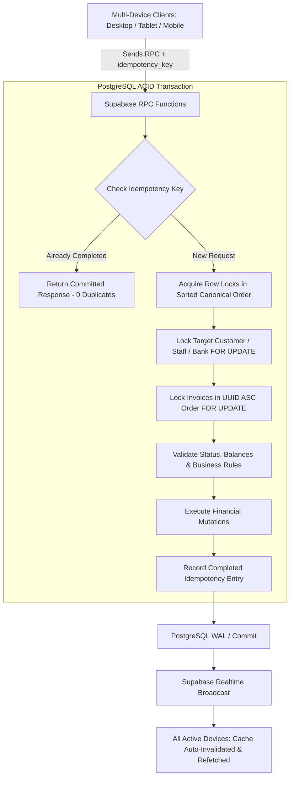

# SIMPLIFY — Comprehensive Concurrency & Multi-Device Risk Audit Report

**Date:** 23 November 2026  
**Auditor:** Antigravity Senior Engineering Team  
**System:** SIMPLIFY Billing, Income & Expense Multi-Tenant SaaS  
**Architecture:** Supabase (PostgreSQL + RLS + PL/pgSQL RPCs) + React PWA Frontend  

---

## Executive Summary

SIMPLIFY operates across multiple devices (desktops, laptops, tablets, mobile phones) used simultaneously by business Owners and Staff. An exhaustive audit of the 27 PostgreSQL database tables, 40+ PL/pgSQL RPC functions, database triggers, RLS policies, TanStack Query caching, and frontend mutation flows was performed to evaluate multi-device concurrency safety.

While foundational features (such as Row Level Security and single-document ACID transactions) exist, the audit identified **14 critical concurrency vulnerabilities** that can lead to lost updates, duplicate financial entries, double deductions, race conditions, and out-of-sync multi-device caches under simultaneous load.

---

## 1. Inventory of Operations Affecting Financial & Ledger Data

| Operation | Database Tables Affected | Execution Mechanism | Current Locking / OCC Status | Risk Level |
|---|---|---|---|---|
| **Create Bill (Invoice)** | `invoices`, `invoice_items`, `invoice_counters`, `jobs`, `job_steps`, `commission_entries`, `receipts`, `receipt_allocations`, `customers` | RPC: `create_invoice` | `invoice_counters` locked via `SELECT FOR UPDATE`; but initial row insertion races. No idempotency key. | **HIGH** |
| **Edit Bill (Unpaid)** | `invoices`, `invoice_items`, `jobs`, `commission_entries` | RPC: `update_invoice` | Row locked via `FOR UPDATE`; but lacks client OCC version check. Rapid simultaneous edits cause lost updates. | **MEDIUM** |
| **Cancel Bill** | `invoices`, `receipts`, `receipt_allocations`, `jobs`, `commission_entries`, `invoice_activities` | RPC: `cancel_invoice` | `invoices` locked `FOR UPDATE`; receipts locked in loop without deterministic ordering. No idempotency key. | **MEDIUM** |
| **Restore Bill** | `invoices`, `receipts`, `receipt_allocations`, `jobs`, `commission_entries`, `invoice_activities` | RPC: `restore_invoice` | `invoices` locked `FOR UPDATE`; customer row unlocked while calculating available advance. | **HIGH** |
| **Receive Payment (Receipt)** | `receipts`, `receipt_allocations`, `invoices`, `customers`, `invoice_counters` | RPC: `create_receipt` | Invoices locked `FOR UPDATE`; but customer row unlocked; multi-invoice locking order non-deterministic (deadlock risk). No idempotency key. | **CRITICAL** |
| **Delete Receipt** | `receipts`, `receipt_allocations`, `invoices` | RPC: `delete_receipt` | Invoices updated; no deadlock-safe lock ordering. | **MEDIUM** |
| **Apply Advance** | `receipts`, `receipt_allocations`, `invoices` | RPC: `apply_advance` | Target invoice and receipt locked; but customer row unlocked. | **MEDIUM** |
| **Money Transfer (Contra)** | `money_transfers`, `bank_accounts` | RPC: `record_money_transfer` | Bank accounts verified via `PERFORM` without row locks. Cross-transfer deadlock risk (A→B vs B→A). | **CRITICAL** |
| **Pay Staff** | `expenses`, `staff_payouts`, `expense_categories`, `members` | RPC: `pay_staff` | No staff row lock; no idempotency key. Double-click duplicates expense and payout. | **HIGH** |
| **Record Loan Repayment** | `loan_repayments`, `loans`, `expenses` | RPC: `record_loan_repayment` | Loan row locked; interest expense created. No idempotency key. | **MEDIUM** |
| **Record Expense / Vendor Payment** | `expenses`, `payments`, `vendors` | Direct PostgREST Insert | Direct `supabase.from('expenses').insert()`. No idempotency key; button double-tap duplicates records. | **HIGH** |
| **Edit Customer / Vendor** | `customers`, `vendors` | Direct PostgREST Update | Direct `supabase.from('customers').update()`. Lacks Optimistic Concurrency Control (OCC). Silent lost updates. | **HIGH** |
| **Tick / Untick Job Step** | `job_steps`, `job_step_events`, `jobs`, `commission_entries` | RPC: `tick_step` / `untick_step` | Step row updated; job completion trigger races if two staff tick final steps simultaneously. | **MEDIUM** |
| **Multi-Device State Sync** | Frontend TanStack Query Cache | Client Memory | **Zero Supabase Realtime channels active.** 2-minute stale cache leaves devices desynchronized. | **CRITICAL** |

---

## 2. In-Depth Concurrency Risk Analysis

### Risk 1: Numbering Sequence Race Condition (`invoice_counters`)
- **Vulnerability:** `next_invoice_number` and `next_receipt_number` execute `SELECT last_number ... FOR UPDATE`. If no counter exists for a financial year, both concurrent transactions execute `INSERT INTO invoice_counters`. One will abort with a unique constraint violation (`uq_invoice_counters`), failing a legitimate bill creation.
- **Remedy:** Atomic PostgreSQL `INSERT ... ON CONFLICT (business_id, fy_label) DO UPDATE ... RETURNING last_number`.

### Risk 2: Duplicate Financial Transactions via Network Retries & Double-Clicks
- **Vulnerability:** When mobile users experience slow network latency, users tap "Save Bill" or "Receive Payment" multiple times. Similarly, mobile network disconnections post-commit trigger client retries. Without an idempotency mechanism, the database treats each retry as a distinct transaction, creating duplicate invoices, duplicate receipts, duplicate staff payouts, and duplicate contra transfers.
- **Remedy:** Implement database-backed `idempotency_keys` table with a 24-hour TTL. Financial RPCs will accept an `idempotency_key`, verifying before execution and returning the committed result on repeat submissions.

### Risk 3: Deadlocks from Non-Deterministic Lock Ordering
- **Vulnerability:** In `create_receipt`, `delete_receipt`, and `cancel_invoice`, multiple invoice allocations are locked in whatever order they were sent by the client. If User 1 allocates to Invoice A then Invoice B, and User 2 allocates to Invoice B then Invoice A, PostgreSQL detects a deadlock (`40P01`) and aborts one transaction.
- **Remedy:** Sort all invoice and receipt IDs deterministically (e.g. `ORDER BY id ASC`) before acquiring row-level locks (`FOR UPDATE`).

### Risk 4: Concurrent Customer Payments & Overwriting Remaining Dues
- **Vulnerability:** When two users simultaneously receive payments for the same customer (Scenario A):
  1. Both calculate customer total due: `SELECT SUM(total - paid_amount) FROM invoices WHERE customer_id = ...`.
  2. Because the `customers` row is NOT locked, both read the same pre-payment due amount.
  3. Both determine how much becomes customer advance based on stale dues.
- **Remedy:** Acquire a row-level lock on the customer record (`SELECT id FROM public.customers WHERE id = v_cust_id FOR UPDATE`) at the start of `create_receipt` and `apply_advance`.

### Risk 5: Race Condition on Unlocked Bank Accounts During Money Transfers (Contra)
- **Vulnerability:** In `record_money_transfer`:
  1. Two users initiate transfers out of Bank Account A simultaneously.
  2. The function checks existence via `PERFORM 1 FROM bank_accounts WHERE id = v_from_id` without locking `bank_accounts`.
  3. Furthermore, if User 1 transfers from Bank A to Bank B, while User 2 transfers from Bank B to Bank A, locking Bank A then Bank B in one transaction and Bank B then Bank A in the other will produce an immediate deadlock.
- **Remedy:** Lock both bank accounts in canonical UUID order (`LEAST(from_id, to_id)` then `GREATEST(from_id, to_id)`) with `FOR UPDATE` before recording the transfer.

### Risk 6: Lost Updates on Customer & Service Edits (Missing OCC)
- **Vulnerability:** Device A and Device B open Customer "Ramesh Kumar" at 10:00 AM.
  Device A edits the mobile number and saves at 10:01 AM.
  Device B edits the address and saves at 10:02 AM.
  Device B's save silently overwrites Device A's updated mobile number because the client performs an unconditional `UPDATE customers SET ... WHERE id = ...`.
- **Remedy:** Implement Optimistic Concurrency Control (OCC) using the `updated_at` timestamp. If `p_last_updated_at` does not match the database row, raise `RECORD_MODIFIED_BY_ANOTHER_USER` with human-friendly guidance.

### Risk 7: Real-Time Desynchronization Across Active Devices
- **Vulnerability:** TanStack Query is configured with `staleTime: 2 minutes`. When Desktop A records a payment, Mobile B continues to display the old unpaid balance until manually refreshed.
- **Remedy:** Establish a centralized Supabase Realtime manager subscribing to `postgres_changes` on core business tables (`invoices`, `receipts`, `customers`, `jobs`, `expenses`, `money_transfers`, `bank_accounts`). On committed changes, selectively invalidate TanStack Query caches without full-page reloads.

---

## 3. Concurrency Protection Architecture Plan

---

## 4. Remediation Action Plan

1. **Database Migration (`20261123000058_enterprise_concurrency_and_idempotency.sql`)**:
   - Create `public.idempotency_keys` table.
   - Refactor `next_invoice_number` & `next_receipt_number` to use atomic UPSERT.
   - Upgrade `create_invoice`, `update_invoice`, `cancel_invoice`, `restore_invoice` with idempotency & canonical lock ordering.
   - Upgrade `create_receipt`, `delete_receipt`, `apply_advance` with customer row locking & deadlock-free invoice locking.
   - Upgrade `record_money_transfer` with canonical bank account locking.
   - Upgrade `pay_staff` and `record_loan_repayment` with idempotency and row locks.
   - Add OCC helper function `update_customer_occ`.

2. **Frontend Concurrency & Realtime Integration**:
   - Create `useRealtimeSync` hook to listen to Supabase Realtime postgres_changes and invalidate TanStack Query caches.
   - Add client idempotency key generation (`crypto.randomUUID()`) to all financial mutation handlers.
   - Add conflict handling UI messages for OCC stale updates.

3. **Multi-Device Concurrent Stress Testing**:
   - Write comprehensive concurrent test suite simulating simultaneous multi-device operations, retries, and race conditions.
